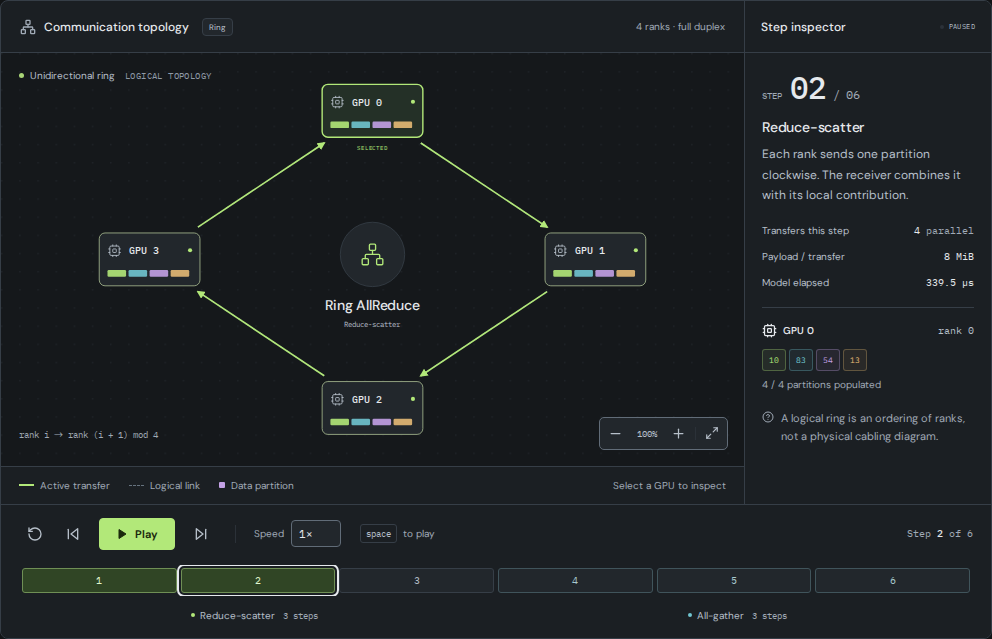

# NCCL Lab

See how data moves between GPUs, one collective step at a time.

NCCL Lab visualizes collective communication with interactive Ring, Tree, and direct schedules. Explore rank buffers, follow individual transfers, and compare a communication model with imported `nccl-tests` results. Everything runs in your browser. No GPUs or CUDA installation required.

**[Open the simulator](https://nccl-lab.pages.dev)** · [Try a four-GPU AllReduce](https://nccl-lab.pages.dev/?op=AllReduce&alg=Ring&n=4&size=32&root=0&red=Sum&bw=50) · [Model reference](docs/model.md)

[](https://nccl-lab.pages.dev/?op=AllReduce&alg=Ring&n=4&size=32&root=0&red=Sum&bw=50)

*The simulator at step 2 of a four-rank Ring AllReduce. Values and timings come from the educational model.*

## Follow your first collective

1. Open the [four-GPU example](https://nccl-lab.pages.dev/?op=AllReduce&alg=Ring&n=4&size=32&root=0&red=Sum&bw=50) with a 32 MiB tensor.
2. Press **Play**, or select a step on the timeline. Steps 1 to 3 reduce the partitions. Steps 4 to 6 distribute the reduced partitions to every rank.
3. Select a GPU to inspect its buffer. Open **Transfer log** to see the routes, payloads, and scalar samples for that step.
4. Change **Algorithm** to **Tree** or **Naive** and compare the schedule. Open **Compare algorithms** to inspect the modeled completion times.

Use `Space` to play or pause, the arrow keys to step, and `R` to reset. **Share configuration** copies a reproducible setup link. **Export trace** downloads the configuration, metrics, and every simulation frame as JSON.

## What you can explore

- Enter any integer from 2 to 16 GPUs and tensor sizes from 4 B to 1 TiB. One GPU represents one rank.
- Choose a root rank and Sum, Average, Min, or Max reductions where the collective supports them.
- Inspect sample buffers, contribution provenance, transfer history, and illustrative C++ NCCL calls.
- Compare modeled completion time, algorithm bandwidth, and bus bandwidth across the supported algorithms.
- Upload or paste `nccl-tests` logs to compare measured times with the model. Logs stay in the browser tab.

## Supported collectives

| Collective | Algorithms | Result |
| --- | --- | --- |
| AllReduce | Ring, Tree, Naive | Reduce values and replicate the result on every rank. |
| Broadcast | Tree, Naive | Copy the root's buffer to every rank. |
| Reduce | Tree, Naive | Reduce values into the root's buffer. |
| AllGather | Ring | Collect every rank's partition on every rank. |
| ReduceScatter | Ring | Reduce values and give each rank one result partition. |
| AllToAll | Naive | Exchange a distinct partition with each rank. |
| Gather | Naive | Collect all partitions at the root. |
| Scatter | Naive | Distribute the root's partitions across ranks. |

`Naive` is the interface label for the direct baseline. `Tree` uses one binomial tree. These schedules explain the communication patterns used by NCCL.

## Run locally

Use Node.js 24 and npm, matching the CI environment.

```sh
git clone https://github.com/ziwon/nccl-lab.git
cd nccl-lab
npm ci
npm run dev
```

Open the URL printed by Vite. The development server binds to `0.0.0.0` for access from another device. The app uses React, TypeScript, and Vite.

To run the checks and create a production build:

```sh
npm run check
npx playwright install --with-deps chromium
npm run test:e2e
```

`npm run build` writes the static site to `dist`. `npm run preview` serves that build locally.

## Understand the model's limits

NCCL Lab is an independent educational tool. It does not execute NCCL kernels or benchmark your hardware.

- The topology shows logical communication. It does not represent physical GPU wiring.
- Timings use synchronous rounds with startup latency and a per-rank bandwidth budget. The model omits compute, pipelining, protocols, and hardware contention.
- Link presets are illustrative. Tree schedules use a single binomial tree rather than NCCL's double-tree implementation.
- The model pads requested sizes into equal float32 partitions and shows the added bytes. Imported benchmark measurements are never padded.
- The 16-GPU cap keeps the visualization readable. It is not a limit of NCCL.

Read the [model reference](docs/model.md) before interpreting timing or bandwidth comparisons.

## Documentation

- [Import and compare benchmarks](docs/benchmark-import.md) covers accepted logs, compatibility checks, and the measured/model ratio.
- [Model reference](docs/model.md) defines tensor sizes, schedules, cost assumptions, and exported samples.
- [Development and deployment](docs/development.md) covers the source map, test commands, and Cloudflare Pages setup.

## References

- [NVIDIA NCCL collective operations](https://docs.nvidia.com/deeplearning/nccl/user-guide/docs/usage/collectives.html)
- [NCCL-tests performance definitions](https://github.com/NVIDIA/nccl-tests/blob/master/doc/PERFORMANCE.md)
- [NCCL-tests console report format](https://github.com/NVIDIA/nccl-tests/blob/master/src/util.cu)

Inspired by [gpu-comm-visualizer](https://github.com/devinjeon/gpu-comm-visualizer). The implementation was written independently.
